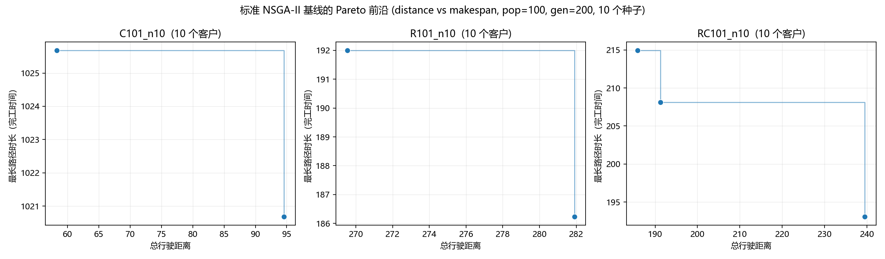

# 多无人机跨江配送路径优化

本项目的研究场景是**多无人机配送**：无人机不能直接飞越江面，必须绕行桥梁或在江对岸起降，且每架无人机都有载重与续航限制。

本仓库是**第一阶段**：可复现的数据基础，以及作为后续改进算法对照标准的**标准 NSGA-II 基线**。

| 项目 | 内容 |
|---|---|
| 基准算例 | Solomon (1987) VRPTW 标准算例集，56 个算例、112 个文件，取自 [PyVRP/Instances](https://github.com/PyVRP/Instances)（MIT） |
| 数据预处理 | 对 56 个算例执行 1120 项校验，**0 错误** |
| 基线算法 | 从零实现 NSGA-II（Deb 等, 2002）：快速非支配排序、拥挤距离、二元锦标赛、(μ+λ) 精英保留 |
| 求解算例 | C101 / R101 / RC101 各取 10 客户的子算例 |
| 测试 | 59 项测试全部通过（`pytest`） |

## 结果概览

标准 NSGA-II 基线在三个 10 客户子算例上的结果，目标为**最小化总行驶距离**与**最小化完工时间**（最长单条路径的时长）。每个算例用 10 个不同随机种子各求解一次，图中前沿是各次运行最终种群的**非支配并集**（已去重）。



| 算例 | 客户数 | 载重 | 总需求 | 继承参考解 | 帕累托前沿 ——（距离, 完工时间） |
|---|---|---|---|---|---|
| `C101_n10` | 10 | 200 | 150 | 1 条路径, 58.33 | **(58.33, 1025.68)** 1 车 · **(94.55, 1020.68)** 2 车 |
| `R101_n10` | 10 | 200 | 124 | 8 条路径, 382.50 | **(269.53, 192.00)** 4 车 · **(281.90, 186.23)** 5 车 |
| `RC101_n10` | 10 | 200 | 220 | 3 条路径, 258.30 | **(185.91, 214.94)** 2 车 · **(191.23, 208.13)** 2 车 · **(239.49, 193.08)** 3 车 |

"继承参考解"是把公开的完整算例最优解裁剪到同样这 10 个客户上得到的解。它是一个可行但通常非最优的上界；在两个较难的算例上，基线明显优于它：

- `R101_n10`：382.50 → **269.53**（改善 29.5%），用 4 辆车取代了 8 辆车；
- `RC101_n10`：258.30 → **185.91**（改善 28.0%）；
- `C101_n10`：基线独立复现出参考解本身（58.326），即这 10 个客户用一条路径服务时成本最低的方案。

这个权衡是真实的：完工时间的每一分下降都要用行驶距离换取。在 `RC101_n10` 上，把任务拆成 3 辆车可将完工时间从 214.94 压到 193.08，代价是距离增加 28.7%；在 `R101_n10` 上，从 4 辆车增加到 5 辆车，用 12.36 的距离换来了 5.77 的完工时间下降。

每个算例的详细结果（含具体路径）在 [`results/`](results/) 目录：`pareto_front.csv`、`runs.csv`（各种子离散程度）、`convergence.csv` 与 `summary.json`。

**种子稳定性**：`R101_n10` 与 `RC101_n10` 在全部 10 个种子下都收敛到相同超体积。`C101_n10` 有 8 个种子找到完整前沿，2 个种子漏掉第二个点（超体积 64703.9，最差 59015.1）——这一情况如实记录，不做平滑处理。

## 快速开始

```bash
python -m pip install -r requirements.txt

python scripts/fetch_solomon.py      # 下载全部 112 个算例文件（约 12 秒）
python scripts/run_preprocess.py     # 校验 + 归一化 + 生成子算例

python experiments/run_baseline_n10.py    # 跑 NSGA-II 基线，输出帕累托前沿（约 6 分钟）
```

只要有任何一项结构性校验失败，`run_preprocess.py` 就会以非零码退出，因此有问题的输入数据不可能悄悄变成论文里的结果。

## 仓库结构

```
data/raw/solomon/          112 个上游 .vrp / .sol 文件 + PROVENANCE.json（校验和）
data/processed/
  instances/<NAME>.json    归一化算例，车场固定为 0 号节点，附带参考解
  subsets/<NAME>_n10.json  10 客户子算例 + 继承参考解
  manifest.csv             每个算例一行的汇总表
  validation_report.json   全部校验项，逐算例记录
src/uavvrp/
  solomon.py               .vrp / .sol 解析、Instance 数据模型、距离约定
  vrptw.py                 路径仿真：时间、载重、等待、完工时间
  preprocess.py            校验、归一化、子算例抽取
  nsga2.py                 NSGA-II（与具体编码无关）
  problem.py               VRPTW 的 split 解码器与目标函数
  viz.py                   帕累托前沿图与收敛曲线
scripts/                   fetch_solomon.py、run_preprocess.py
experiments/               run_baseline_n10.py
tests/                     59 项测试
docs/data_notes.md         数据校验结论，以及上游算例的两处缺陷
results/                   生成的前沿结果、CSV 与图片
```

## 一、数据流水线

`scripts/fetch_solomon.py` 通过上游仓库的 GitHub API 获取完整 Solomon 算例集，并把每个文件的 SHA-256 与上游 commit 记录在 `data/raw/solomon/PROVENANCE.json` 中，便于随时复核：

```bash
python scripts/fetch_solomon.py --verify
```

`scripts/run_preprocess.py` 随后载入全部 56 个算例并执行 **1120 项校验**：

- 声明的 `DIMENSION` 与各 section 实际行数一致；
- 有且仅有一个车场，其需求与服务时间均为 0；
- 所有节点满足 `ready <= due`，且每个客户都能在其自身时间窗内从车场到达；
- 每个客户需求都不超过单车载重，声明的车队总量足以承运总需求；
- 每个参考解都**恰好服务每个客户一次**，且用车数不超过车队上限。

之后把每个算例归一化成 JSON（车场固定为 0 号节点），抽取基线所需的固定规模子算例，并写出汇总表与完整校验报告。

### 上游算例数据的两处缺陷

流水线发现了两处**本来就存在于公开算例文件中**的不一致，它们不是本代码的产物。这些校验项按 *advisory*（提示性）处理：带完整证据记录、单独计数，既不会被悄悄放过，也不会让流程失败：

1. **全部 56 个算例声明的 `Cost` 与其自带路径对不上。** 重算值恒比声明值高 1.6–5.2（0.2%–0.5%）。例如 C101 声明 `827.3`，但其自带路径的实际成本是 **828.94**——恰好等于公开流传的 C101 标准解文本所给的值。也就是说，声明值是更优的公开最优解，而随文件附带的路径是一个略有不同的近似最优解。
2. **56 个参考解中有 8 个违反时间窗**，超出量都不到 0.4 个时间单位，正是 100 客户路径上累积的舍入误差量级；没有任何一条路径超出车辆载重。

两处缺陷的完整分析和复现步骤见 [`docs/data_notes.md`](docs/data_notes.md)。对基准比较的结论也写在那里：与文献比较时引用 `ref_cost_published` 列，与自己跑的基线比较时应使用 `ref_cost_recomputed` 列。

## 二、NSGA-II 基线

### 问题建模

一个个体的编码是 `(客户排列 perm, 请求车辆数 k)`。解码器用一个动态规划把 `perm` 切成恰好 `k` 段连续路径，在满足载重与时间窗的前提下最小化总距离（即 Prins 的 *split* 过程）。因此**每一个解码出的解都天然可行**——不需要修复步骤，也没有惩罚项；若请求的 `k` 无法达到，就把它修正到最接近的可行车辆数并写回基因型。

目标函数（均为最小化，可任选两个组成双目标）：

| 目标 | 含义 |
|---|---|
| `distance` | 所有路径的总行驶距离 |
| `makespan` | 最长单条路径的时长（行驶 + 服务 + 等待） |
| `vehicles` | 使用的路径（车辆）条数 |
| `waiting` | 总等待时间 |

### 算法

`src/uavvrp/nsga2.py` 直接按 Deb 等 (2002) 实现，不依赖任何演化算法框架，每个算子都可以逐行审查：快速非支配排序（O(MN²)）、边界解取无穷大的拥挤距离、先比 rank 再比拥挤距离的二元锦标赛、(μ+λ) 精英保留。排列编码部分使用顺序交叉（OX）与交换/移位/逆序变异，而不是实数编码的 SBX 与多项式变异——这是排程类问题的标准做法。

**有一处刻意的补充。** 精英保留会把整个前沿原样接收，而目标向量相同的解互不支配，于是一整份"同一个解的副本"会被完整保留。在本项目的算例上实测：这样做会让种群在几代之内坍缩到 **100 个个体里只剩 2 个不同解**，变异与交叉彻底失去可用的多样性。因此实现里增加了一步在实际可用的 NSGA-II 代码中很常见的处理：把目标向量重复的个体用变异重新生成并重新评价。它让评价次数增加 20%–25%，但收益明显——种群能维持 100 个不同解，`RC101_n10` 的超体积提升 7.4%（22856 → 24558）。把 `deduplicate=False` 即可退回到未经修改的原始流程。

### 目标函数怎么选

默认使用 `distance` 对 `makespan`，因为这两个目标存在真实冲突。

而 `distance` 对 `vehicles` 在本解码器下**并不冲突**，程序会直接把这一点报告出来，而不是悄悄返回一个单点前沿。原因是：解码器在给定车辆数下最小化距离，而给一个可行方案增加车辆绝不可能缩短总距离，所以总距离关于车辆数单调不减——车辆越少，两个目标同时越好，任何车辆更多的方案都被支配。实测各车辆数下的最小距离为：

```
C101_n10   k=2: 100.43   k=3: 121.47   k=4: 152.02   k=5: 182.27  ...
RC101_n10  k=3: 261.04   k=4: 309.05   k=5: 365.84   k=6: 431.36  ...
R101_n10   k=4: 289.47   k=5: 281.90   k=6: 314.46   k=7: 334.92  ...
```

只有 `R101_n10` 在 k=4 与 k=5 之间存在真实权衡。这是建模方式的固有性质，不是搜索失败：要得到有意义的车队规模前沿，解码器必须真正在距离与车辆数之间做权衡——例如加权和 split，或在 split 目标中加入每辆车的固定成本。这属于后续工作。

## 复现本文结果

```bash
# 正文图表所用的前沿
python experiments/run_baseline_n10.py --objectives distance makespan \
    --pop 100 --gen 200 --seeds 10 --out results

# 用于对照的车队规模目标
python experiments/run_baseline_n10.py --objectives distance vehicles \
    --pop 100 --gen 200 --seeds 10 --out results
```

随机种子固定为 `1..10`，因此结果可以逐位复现。每个算例跑 10 个种子约需 110–130 秒（单次约 11 秒、约 25000 次评价），纯 Python 实现。

```bash
python -m pytest tests -q       # 59 项测试
```

测试套件用 C101 锁定了距离约定（自带路径必须重算出 828.94 ± 0.01），并覆盖解析器、"求解器严格容差"与"公开数据校验容差"的区分、解码器的可行性与车辆数修正、快速非支配排序与拥挤距离（对照手算结果）、超体积（对照解析值），以及一个已知解析前沿的玩具问题上 NSGA-II 的端到端运行。

## 后续工作

第一阶段刻意只建模**单一车型、不含跨江限制、不含续航限制**，以便第二阶段有干净的对照基准。计划开展的工作：

1. **跨江约束**——在配送区域内给定一条河流折线；任何一段航路都不得直线跨江，受影响的航段必须绕行桥梁，或改由江对岸起降。
2. **无人机载重与续航限制**——把每架无人机的载重与飞行时间上限作为硬约束写进路径可行性判断，取代现在单一的载重约束。
3. **ALNS 精英解局部增强**——本项目的核心创新点：在每一代 NSGA-II 之后，只对 rank-1 精英解执行自适应大邻域搜索（破坏 → 贪婪修复 → 模拟退火接受，配合自适应算子权重与停滞计数器）。当前前沿较"薄"（只有 2–3 个点）正是这一层的动机：基线收敛稳定，但恰好留下了可以做局部深挖的空间。
4. **更丰富的车队规模前沿**——按上文所述改用加权和 split 解码器。

## 数据与许可

代码使用 MIT 许可，见 [`LICENSE`](LICENSE)（该文件保留英文原文，以便许可证文本的效力与通用解释保持一致）。`data/raw/solomon/` 下的文件是 Solomon (1987) VRPTW 标准算例，转载自 [PyVRP/Instances](https://github.com/PyVRP/Instances)（MIT），后者转发了最初由 SINTEF 与 VRP-REP 分发的算例集。这些文件仅用于可复现的基准测试，一切权利归原作者所有。逐文件 SHA-256 与上游 commit 见 `data/raw/solomon/PROVENANCE.json`。
